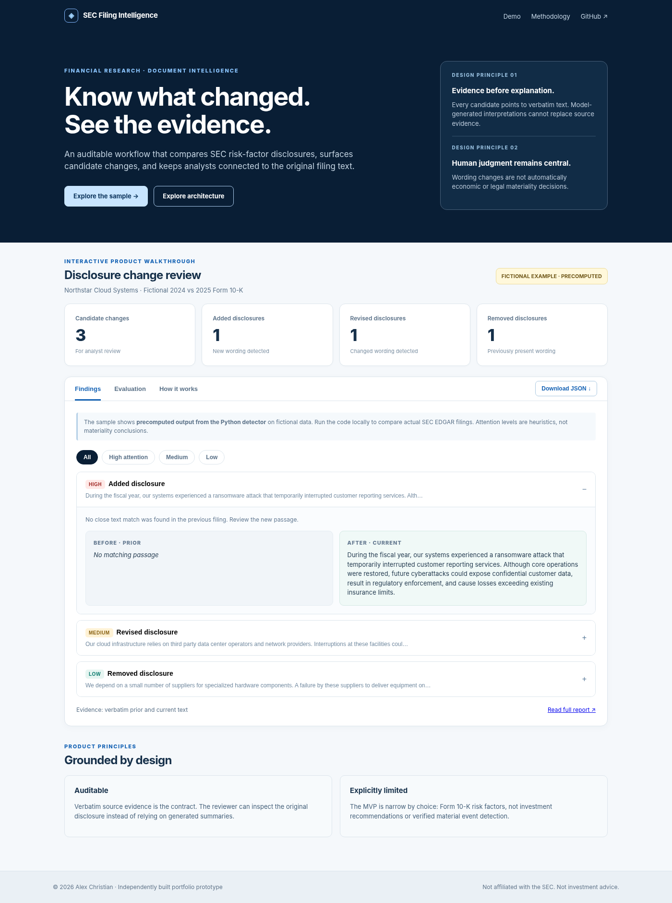
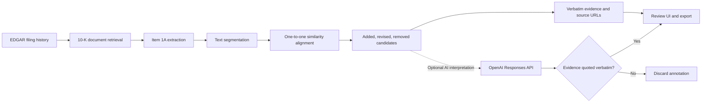

# SEC Filing Intelligence

**An evidence-first disclosure change detection prototype for financial research teams.**

Compare consecutive SEC Form 10-K *Item 1A: Risk Factors* disclosures. The workflow discovers filings from SEC EDGAR, identifies candidate additions, revisions, and removals, and returns **verbatim before/after evidence linked to the original SEC filings**. An optional OpenAI step adds strictly labeled interpretation; source evidence remains deterministic.

This is a **personal, independently implemented portfolio project** using public SEC APIs and fictional demonstration data. It contains no employer code, internal documentation, private filings, or proprietary research.

> **Working MVP, not a production financial research system.** Textual differences are not necessarily changes in economic risk or legal materiality. The included evaluation suite contains only synthetic regression cases.



## Browser demo

The [recruiter-friendly browser walkthrough](https://alexanderwchristian.github.io/sec-filing-intelligence-agent/) visualizes a **precomputed, fictional** output of the Python detector. It runs as static GitHub Pages (no API keys or SEC rate limits). The Streamlit app below runs live retrieval and actual comparisons. To publish the static demo, enable GitHub Pages from the `main` branch `/docs` folder after pushing the repo.

## Product preview

Run the local demo without credentials, SEC access, or an API key:

```bash
pip install -e .
filing-intel demo
```

The fully fictional **Northstar Cloud Systems** example detects:

| Candidate | Illustration | Why review |
|---|---|---|
| Added | Ransomware-related risk paragraph | New disclosure language |
| Revised | Data-center dependency wording | New concentration-related wording |
| Removed | Hardware supplier risk paragraph | Previously disclosed risk language absent |

Every finding contains the **exact excerpts** from each analyzed text and the available source URLs. [View the example evidence report](examples/sample_report.md) or [structured JSON](examples/sample_report.json).

## Launch the interface

Requires Python 3.11 or newer.

```bash
python -m venv .venv
source .venv/bin/activate           # Windows: .venv\Scripts\activate
pip install -e '.[ui]'
streamlit run app.py
```

Three modes are available:

1. **Synthetic demo**: runs entirely offline, no setup.
2. **Live SEC**: enter a ticker or CIK, such as `AAPL` or `320193`, plus the SEC-required identification header. Fetches two most recent 10-K filings and compares their Item 1A sections.
3. **Your text**: compare two pasted sections without downloading any filings. Do not paste confidential information.

For live SEC mode, set a real contact identity in your shell or enter it in the UI:

```bash
export SEC_USER_AGENT="Your Name your-real-email@yourdomain.com"
filing-intel live --company AAPL --out filing_review.md
```

Use the environment variable locally rather than committing your email, API key, or `.env` file. The SEC provides [public filings without an API key](https://www.sec.gov/search-filings/edgar-application-programming-interfaces) but expects **identified, rate-limited automated access**. This client throttles to approximately 2 requests/second and includes bounded retries. See [SEC Developer Resources](https://www.sec.gov/about/developer-resources).

### Optional AI interpretation

The detector operates without any LLM. To experiment with model-generated explanations:

```bash
pip install -e '.[ai]'
export OPENAI_API_KEY="your-api-key"
filing-intel demo --ai
```

A model only annotates already-detected changes. It must return evidence strings that appear verbatim in the supplied excerpts; mismatched evidence invalidates the annotation. Commentary is marked as **AI interpretation requiring human review**, not as source facts. Model availability and API charges depend on your account.

## Architecture



**Design decisions**

- **Evidence before explanation:** All claims about changes must be supported by text present in the actual comparison inputs.
- **Fail closed on extraction:** If an Item 1A section cannot be identified, the live workflow raises an error instead of analyzing the wrong section.
- **Transparent detection:** A token-overlap shortlist and one-to-one text alignment produce change candidates. There is no opaque automatic "material" verdict.
- **Human-in-the-loop:** Attention tiers are keyword heuristics for triage, not legal or financial materiality determinations.
- **Two levels of model use:** Non-LLM mode keeps the comparison deterministic and reproducible. Optional LLM mode generates reviewed annotations without replacing evidence.

## Evaluation and testing

```bash
pip install -e '.[dev]'
pytest
filing-intel evaluate
```

The included `examples/evaluation_cases.json` contains **five entirely synthetic** regression scenarios covering an addition, revision, removal, unchanged text, and reordered text. The suite measures exact event-type and evidence-substring matches using precision, recall, and F1. It is primarily a development sanity check, **not a credible estimate of performance against real SEC disclosures**.

Next research milestones are (1) a manually labeled public 10-K evaluation set, (2) a semantic paraphrase stress test, (3) a false-positive review workflow, (4) latency and failure-rate instrumentation, and (5) section-specific source anchors.

## Current limitations

- The live prototype supports **Form 10-K, Item 1A only**. It does not currently monitor fund prospectuses, fee tables, portfolio managers, or other fund-specific disclosure types.
- SEC filings are not uniformly formatted. Some HTML and table-of-contents structures may cause extraction errors or missed paragraphs.
- Similar wording can describe different risks and different wording can describe the same risk. Reordering, boilerplate, and paraphrases are hard cases.
- The risk attention tier is based on keywords, **not materiality, prediction, or investment recommendation**.
- Evidence URLs point to the original **filing**, not to a guaranteed in-page paragraph anchor. Use the excerpt to find the text in the filing.
- Public EDGAR availability and rate limits can affect live retrieval. The synthetic demo always works offline.
- This prototype does not run continuously, store alerts, or claim production-grade recall.

## Project structure

```text
app.py                       Interactive Streamlit review UI
src/filing_intel/sec.py      SEC filing lookup, compliant retrieval
src/filing_intel/parser.py   Risk section extraction and segmentation
src/filing_intel/detect.py   Candidate alignment and triage
src/filing_intel/ai.py       Optional evidence-validated LLM annotations
src/filing_intel/evaluate.py Synthetic regression metrics
src/filing_intel/cli.py      Local demo, live analysis, evaluation
examples/                    Fictional filing data and reproducible outputs
tests/                       Unit and mocked SEC integration tests
.github/workflows/tests.yml  Automated tests on three Python versions (included in project package; verify uploaded GitHub dotfiles)
```

## Planned v2: autonomous filing research agent (not yet implemented)

**Stage 1, PR1 now adds local durable issuer monitoring:** configurable CIK/ticker watchlist, complete accession inventory with incremental document retrieval, immutable SQLite history, 10-K Item 1A comparison, backfill/recovery and JSON status/results. See [setup, decisions, measured tests and remaining live gate](docs/PR1_MONITORING.md). Amendment analysis, other forms, research, scheduling and email remain planned. The live SEC acceptance rehearsal passed on one Apple annual filing pair; broader real-world evaluation remains outstanding.

The next iterations will analyze amendments and additional forms, detect fund events, perform bounded evidence-backed investigation, and deliver a daily research briefing. **These expanded capabilities remain specifications.**

- [Product requirements and acceptance criteria](docs/PRODUCT_REQUIREMENTS.md)
- [Filing coverage and phased jurisdictions](docs/FILING_COVERAGE.md)
- [Canonical event and evidence schema](docs/EVENT_SCHEMA.md)
- [Architecture and agent/tool boundaries](docs/ARCHITECTURE.md)
- [Evaluation design and release gates](docs/EVALUATION.md)
- [Scheduling, recovery and delivery operations](docs/OPERATIONS.md)
- [Reviewable implementation plan](docs/IMPLEMENTATION_PLAN.md)
- [Verified current state versus planned scope](docs/SOURCE_CONTEXT.md)
- [Codex instructions](AGENTS.md)

Before coding new features, review entity identity, first supported fund forms, durable storage, digest delivery choices and evidence requirements.

## Why this product

Investment analysts can spend substantial time reviewing recurring disclosures. The design goal is to **reduce the first-pass review burden without hiding the supporting documents**. A useful first prototype should prioritize auditable evidence, understandable failure modes, and a workflow that helps a human decide what to inspect next.

**Built as an independent portfolio prototype.** No affiliation with or endorsement by the U.S. Securities and Exchange Commission. Not investment advice.
