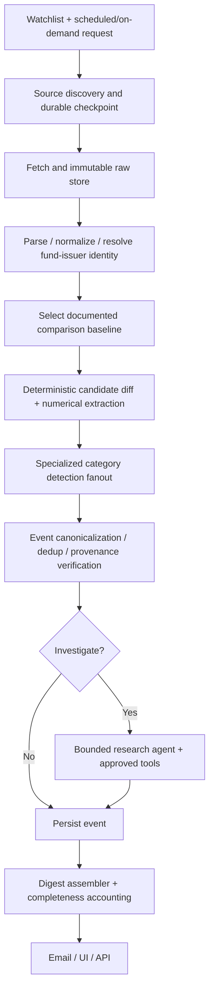

# Target architecture and agent boundaries

**Status:** target architecture; [PR1](PR1_MONITORING.md) implements the issuer 10-K discovery/storage/parse/baseline/detection slice in `monitor.py` and `store.py`, reusing existing modules. Other components remain proposed.

**Hard product boundary:** Two US SEC entity tracks only: (1) mutual fund / ETF filings and (2) public-company stock filings. Shared discovery, persisted events, investigation, UI and digest; separate form-specific parsers and detectors. See [FILING_COVERAGE.md](FILING_COVERAGE.md). The application is not complete until both tracks reach the shared live dashboard and daily delivery.

## Primary pipeline

## Responsibilities
**Discovery tool (deterministic):** load watchlist, poll official feeds, list accessions, track delays/amendments, rate-limit and checksum documents. Store per-source cursors plus periodic lookback sweep. It returns complete/partial/failure state and discovery audit.

**Normalization tool (deterministic):** parse HTML/tables/XBRL, retain original and normalized document, source sections/spans, dates, entities, jurisdiction, document family and parser provenance. Reject low-confidence section extraction rather than guessing.

**Baseline selector (deterministic with policy):** compare correct entity/class/period/form; record why baseline chosen, including amendments and prior prospectuses. The model does not pick an arbitrary previous filing.

**Detector fanout:** start with deterministic structural/value diffs and narrow classification models per event family: portfolio managers; benchmarks; fees/expenses; investment objectives/policies; launches/closures/mergers; issuer risks; management/governance; liquidity/financing; results/financial events. A registry maps detector to eligible forms/sections and known schema. A detector must return typed candidate events with evidence or explicit abstention.

**Consolidator (deterministic):** validate quotes and entity/effective dates against source, deduplicate repeated disclosure across filings/share classes as warranted, track correction/supersession, preserve all candidate events and count full inventory. If model output cannot be grounded, quarantine for review.

**Research agent (bounded):** given candidate + cited sources, choose from allowlisted tools (`get_filing`, `find_section`, `fetch_prior_disclosure`, `search_related_accessions`, `get_company_facts` when relevant, `get_event_history`). It may examine related amendments/historical filing context, propose precise follow-up questions and report confidence/unknowns. It must not execute trading or arbitrary web actions, and must stop after configurable tool-call/time/token budgets. All tool responses use typed contracts and redact secrets. Prefer one agent plus tools before adding multi-agent delegation; specialized detection fanout is enough for the MVP.

**Serving/delivery:** single queryable persisted event state serves CLI, Streamlit dashboard, daily digest, email and future API. A precomputed GitHub Pages demo must remain clearly marked fictional/static, not represented as live monitoring.

## Graph state and execution interfaces
`PipelineRequest {mode, watchlist_version, scope, as_of, lookback_policy, run_id}`; `PipelineState {discovered_docs, fetched_docs, parse_results, baselines, candidate_events, verified_events, investigated_events, failures, checkpoint}`. Each node emits typed input/output and bounded metrics. Graph transitions are logged and checkpointed. Scheduled and on-demand calls share the same middle stages, but differ in trigger and delivery channel.

## Storage and deployment recommendation
- **Developer mode:** SQLite with migration scripts, CLI and local Streamlit, no public secrets.
- **Scheduled mode:** Postgres or equivalent durable managed relational store with optional object storage for raw filings, transactional checkpoints and email send ledger. GitHub Actions only triggers jobs; it is not storage.
- Index `accession`, source document hash, `(watch_id, source, discovered_at)`, event fingerprint, and run ID. Preserve raw bytes with retention/licensing review.
- Keep secrets in environment/CI secrets, minimal scopes, and protected server-side only. Add dependency pinning, audit logging, cost caps, and prompt-injection isolation: treat filing and web text as untrusted *data*, never instructions.

## Failure behavior
A failed source does not stop independent entities, but run status becomes partial. Retries use bounded exponential backoff; DLQ/replay records failures. Missing baseline is an explicit first-seen/no-comparison result, not 'unchanged'. An ambiguous entity maps to needs-review. Model timeout falls back to uninvestigated evidence-linked candidates, not fabricated conclusions. A failed email uses the send ledger to avoid duplicates.

## Architecture tradeoffs
- Starting with fixed category detectors and deterministic evidence makes outcomes auditable; semantic recall may initially be lower.
- Tool-using agents are appropriate for context gathering and next actions, not raw ingestion or evidence generation.
- Use existing Python libraries before introducing complex infrastructure. Choose orchestration frameworks based on tests and observability, not portfolio aesthetics.
- Avoid broad claims of autonomous discovery until benchmarked coverage and unattended daily operations are demonstrated.
